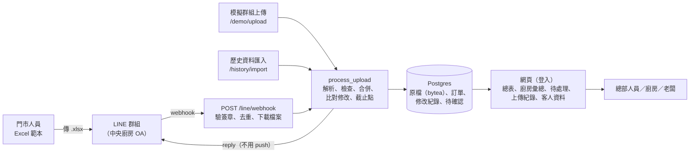

# 喜餅訂單匯流

**English summary.** A bakery chain's six stores keep wedding-cake (喜餅) orders in Excel and already send the file to the central kitchen through a LINE group. This project keeps that habit: the stores fill in one shared Excel template and send it to a group that includes the kitchen's LINE Official Account. The backend (FastAPI + Postgres, no LLM) stores every original file, checks each row, merges the orders into one master list, classifies changes to orders already on record, holds production changes made too close to pickup for HQ review, and replies in the group with exactly what was accepted, what was refused and why. HQ, the kitchen and the owner log in to web pages for the master list, the kitchen's production summary, pending reviews and customer records. `docker compose up --build` runs it locally; `uv run bakery-demo --reset` replays the nine-step demo story against it. Everything is in Traditional Chinese below.

## 要解決的問題

中部一家老字號糕餅連鎖有 6 家門市和 1 個中央廚房，喜餅約占營收四成。各門市把喜餅訂單記在自己格式的 Excel，再用 LINE 把檔案傳給中央廚房；改單時只改掉 Excel 裡的一格，沒有人檢查，也沒有一份大家都信得過的總數，上一季就有 3 筆日期或數量記錯，造成退款和負評。這個專案不改門市的習慣：門市照舊記 Excel、照舊把檔案傳進 LINE 群組，只是換成一份統一的範本，群組裡多了中央廚房的 LINE 官方帳號（OA）。後端保存每一份原檔，逐列檢查、合併成總表，比對出哪些單被改了，過了修改截止點的修改先交給總部確認，並在群組裡回覆傳檔的人：收了什麼、哪一列沒收、為什麼。

## 架構



- 所有上傳來源（LINE webhook、模擬群組上傳、歷史資料匯入）都呼叫同一個 `process_upload`；回覆文字只在 `src/bakery/reply.py` 由結構化的檢查結果產生。
- 處理流程不用 LLM，解析、檢查、合併、比對都是確定的規則。
- 原檔和修改紀錄只增不改。一次上傳是一批訂單明細，不是快照：檔案裡少了某張單，不代表取消（`docs/adr/0001-upload-is-a-batch-not-a-snapshot.md`）。
- 正式環境：Cloud Run（`asia-east1`）＋ Neon Postgres；本機：`docker compose`（app＋Postgres）。

## 怎麼跑

需要 Docker 和 [uv](https://docs.astral.sh/uv/)。

### 本機啟動

```sh
docker compose up --build
```

`init` 服務先跑 `bakery-init`（Alembic 升到最新版本，種入門市、品項、demo 傳檔者和 demo 帳號，可重跑），`app` 才啟動。開 <http://localhost:8000>，用下面的 demo 帳號登入（門市沒有帳號，也不需要登入）。

### 跑 demo 劇本

另開一個終端機，在 repo 根目錄執行：

```sh
uv sync
uv run bakery-demo --reset
```

這個指令透過 HTTP 操作網站，跟人在瀏覽器裡點的一樣：以 `hq-lin` 登入，用模擬群組上傳頁替門市傳檔，依序跑完下面 9 步。每一步印出 LINE 群組會收到的回覆，以及該打開的網頁網址；回覆跟劇本不同就停下來，說明哪裡不對。

1. 台中中正店傳了一份有錯的檔案（一列漏單號、一列盒數填 0），回覆逐列指出問題。
2. 門市補上單號、改好盒數後重傳，廚房彙總的盒數跟著增加。
3. 門市把一張單的龍鳳喜餅從 80 盒追加到 120 盒，直接生效。
4. 門市追加一張 6 天後取貨的單，已過修改截止點（取貨日前 7 天），變成待確認，廚房彙總先照原本的盒數算。
5. 總部人員在待處理頁退回這筆修改。
6. 門市又傳了同樣的內容，回覆最前面是總部的處理結果，並提醒「已被總部退回」。
7. 門市把 Excel 改回原本的數字，提醒消失。
8. 其他五家門市也傳了檔案，客人資料頁看得到回頭客（包括在兩家門市、用不同姓名下單的同一支電話）。
9. 用轉換工具把兩家門市的舊 Excel 轉成範本，總部人員匯入歷史資料，多出只靠舊單才認得出的回頭客。

說明：

- 每次執行都先用今天的日期重新產生模擬檔，輸出到 `demo_data/`（不進 git），對照表在 `demo_data/對照表.md`。repo 裡的 `mock_data/` 固定在 2026-10-21，日期會過期；第 4 步需要「6 天後取貨」，所以用今天重新產生。
- 劇本要從空的資料庫開始。`--reset` 會先清空本機 compose 的資料庫（`docker compose run --rm init bakery-init --wipe-all-data`），再重新種入參考資料和 demo 帳號。資料庫裡已經有訂單又沒加 `--reset`，指令會直接停下來。
- 對部署好的網址執行：`uv run bakery-demo --base-url https://<服務網址>`，資料庫要是空的。要清空部署環境的資料庫，必須同時給連線字串和 `--wipe-remote`，少一個就拒絕，不會誤刪：
  ```sh
  uv run bakery-demo --base-url https://<服務網址> --reset \
    --database-url 'postgresql://...neon.tech/neondb?sslmode=require' --wipe-remote
  ```

### 測試

```sh
uv run pytest   # 需要 Docker（testcontainers 每次測試起一個 Postgres）
```

`tests/test_demo.py` 用測試用的 app 把整段劇本跑一次，改了程式之後劇本跑不通，測試就會失敗。

其他常用指令：

- 重新產生範本、模擬檔與對照表：`uv run generate-mock-data [--today YYYY-MM-DD] [--seed N]`（預設輸出到 `mock_data/`）。
- 舊格式檔轉範本：`uv run convert-legacy <門市代碼> <舊檔.xlsx> [-o 輸出.xlsx]`。

## Demo 帳號

`bakery-init`（本機由 compose 的 `init` 服務執行，部署時由 Cloud Run job 執行）會建好這幾個帳號，密碼都是 `demo1234`：

| 帳號 | 誰 | 看得到 |
|---|---|---|
| `hq-lin` | 總部人員 林雅文 | 全部營運頁面：總表、待處理（可確認、退回）、上傳紀錄、門市綁定（可確認）、品項（可新增）、修改截止點（可改）、模擬群組上傳、客人資料、歷史資料匯入 |
| `hq-chen` | 總部人員 陳志明 | 同上（總部每人一個帳號，紀錄裡才分得出是誰做的） |
| `kitchen` | 中央廚房（共用） | 只有總表和廚房彙總 |
| `owner` | 老闆 | 全部頁面（待處理、門市綁定、品項、修改截止點只能看，處理由總部人員做；歷史資料匯入只有總部人員能做） |

密碼只存 argon2 雜湊。登入狀態是簽章過的 cookie，金鑰來自環境變數 `SESSION_SECRET`；本機沒設定時用開發用的預設值。部署時設 `BAKERY_ENV=production`，這時沒有設定 `SESSION_SECRET`（或少於 32 字元、或用的是預設值）app 會拒絕啟動，cookie 也只走 HTTPS。

## 模擬群組上傳頁

`/demo/upload`（總部人員和老闆可開，門市不會看到）：選一位傳檔者、上傳一份範本檔，畫面上顯示的回覆，就是 LINE 群組裡會收到的內容。

為什麼要有這一頁：真的 LINE 群組要先建好官方帳號、群組和部署好的網址才能用，而且只有群組成員看得到。這一頁讓沒有 LINE 群組的人（看 demo 的人、還沒接上 LINE 的本機環境）也能走完整個流程。它跟 LINE webhook 呼叫同一個 `process_upload`，門市綁定的檢查也一樣，所以在這裡看到的回覆，跟群組裡的會是同一段文字。demo 劇本（`bakery-demo`）也是透過這一頁替門市傳檔。

傳檔者有六個「門市帳號」，預先綁好各自的門市；「美玲（台中中正店）」還沒綁定，用她傳第一次，就會看到「已記錄您為 ○○店（待總部確認）」的流程。每一份從這頁送出的上傳，上傳紀錄都會記下是哪個登入帳號送的。

## 網頁

- 總表：`/orders`，可以依門市和取貨日篩選，`下載 .xlsx`（`/orders.xlsx`）的內容跟畫面上一樣（同樣的篩選）。總部人員和老闆點單號，會開該張喜餅訂單的稽核頁 `/orders/<id>`：目前內容，加上每一次帶進或改到這張單的上傳（傳檔者、時間、欄位、舊值→新值）。修改紀錄只能新增，資料庫會擋下改寫和刪除。
- 廚房彙總：`/kitchen`（所有帳號）。依「取貨日 × 品項」加總盒數，預設從今天（台北時間）起 14 天，日期範圍可以調整；勾日期展開各門市的數量（或「全部展開各門市」）。取消的不算，歷史資料不算。修改還在等總部確認的單，先照修改前的盒數算，數字旁標「有待確認」，頁面下方列出是哪幾張單。`下載 .xlsx`（`/kitchen.xlsx`）的內容跟畫面上一樣：各門市的列收在每天的合計列底下（Excel 的群組，可展開），「有待確認」是數字上的註解。群組裡的每一則回覆，最後一行都是廚房彙總的連結（`PUBLIC_BASE_URL` + `/kitchen`）。
- 上傳紀錄：`/uploads`，每一份原檔都可以下載，也記錄是從 LINE 還是由哪個帳號在模擬頁送出的。處理失敗的上傳會標「處理失敗」並留下原因。
- 待處理：`/reviews`（總部人員確認或退回；老闆只能看）。會進來的有兩種：過了修改截止點、又影響生產的修改（追加、減量、改取貨日、取消），以及疑似單號重複使用（不看截止點）。資料更正不管哪天都直接套用。每一筆列出門市、單號、修改類型、舊值→新值、哪一次上傳；處理後記下是誰、什麼時間。確認才套用，退回就沿用修改前的內容。結果不推播，附在該門市下一次上傳的回覆最前面（「【總部已處理您之前的待確認】」）。門市重傳一模一樣的修改，不會多一筆待確認，回覆只提醒「仍待總部確認」或「已被總部退回，系統仍以 80 盒計算，請把 Excel 改回 80」；改回原本的數字，提醒就不見。總部處理前門市又傳了別的內容（或改回原本的內容），舊的那筆就不用處理了，以新傳的為準。
- 修改截止點：`/settings`（總部人員可改；預設 7）。截止點是取貨日前 N 天：那一天傳來的修改還直接套用，隔天起（離取貨日不到 N 天）影響生產的修改就變待確認。改取貨日時，新舊兩個取貨日取比較早的那個算。
- 品項：`/products`（總部人員可新增品項和品項別名；老闆只能看）。範本「品項」欄要跟品項名稱或別名完全一樣才收；補上之後門市重傳同一份檔案，原本沒收的列就會收進來。
- 門市綁定：`/bindings`。傳檔者第一次傳範本檔時，系統依檔案裡的門市代碼先記錄他屬於哪家門市（回覆第一行「已記錄您為 ○○店（待總部確認）」），總部人員在這頁確認或改成正確的門市。已綁定的傳檔者傳了別家門市的檔案，照常處理，但回覆會提醒。
- 模擬群組上傳：`/demo/upload`，見上一節。
- 客人資料：`/customers`（總部、老闆）。一支正規化後的電話算一位客人：訂單數、總盒數（不含取消）、第一次和最近一次接單日、下過單的門市、訂購人姓名（同一支電話有不同姓名會標出來），點進去看每一張喜餅訂單；可下載 `/customers.xlsx`。不是會員，頁面上沒有發訊息的功能；網址用單的 id，不放電話。客人資料每次都從訂單即時算出，不另外存。
- 歷史資料匯入：`/history/import`（只有總部人員）。門市上線前的舊訂單分兩步進來：
  1. 導入人員（FDE）用轉換工具把舊 Excel 轉成範本。每家門市的舊格式不同，一家一個轉換器（目前有 TC02、CH01）：
     ```sh
     uv run convert-legacy TC02 mock_data/legacy/TC02_台中北屯店_舊訂單.xlsx
     uv run convert-legacy CH01 mock_data/legacy/CH01_彰化中華店_舊訂單.xlsx
     ```
     輸出到 `legacy_converted/<門市代碼>_<門市>_歷史資料.xlsx`（`-o` 可改）。舊單沒有單號，轉換工具補 `H-<接單日>-<序號>`（例如 `H-20260523-01`），一看就知道是歷史資料。同一份舊檔重轉，輸出一個 byte 都不差，單號也一樣。看不懂的日期、拆不出品項的「其他」欄會停下來列出位置；不在商品清單裡的品名照寫並提醒。
  2. 總部人員在這頁上傳轉好的範本（可一次多個）。跟一般上傳走同一個 `process_upload`，原檔一樣保存、修改紀錄一樣記成新單；差別是訂單標成歷史資料（`is_historical`）、不提醒取貨日已過、不會有待總部確認的修改、沒有傳檔者也不回覆 LINE，結果只顯示在頁面和上傳紀錄。同一份檔案重複匯入不會多出訂單；上線後門市已經傳過的單號，歷史資料不會蓋過它。匯入後，客人資料就看得到這些舊單（標「歷史資料」），只靠舊單才認得出的回頭客也會出現。歷史資料的取貨日都已經過了，而且有 `is_historical` 標記，廚房彙總不算它們。

## 文件

- [需求文件](docs/requirements/requirements.md)：情境、設計原則、範本、功能與非功能需求、不在範圍內的事。
- [設計說明](docs/design.md)：核心問題與假設、MVP 怎麼切、技術選型、接下來幾週、第一次開會要問的問題（`scripts/export-design-pdf.sh` 可匯出 PDF）。
- [給老闆的一頁說明](docs/boss-one-pager.md)：第一週會拿到什麼、要誰配合什麼、怎麼判斷成功、什麼結果就停下來。

名詞定義在 [`GLOSSARY.md`](GLOSSARY.md)，設計決定在 [`docs/adr/`](docs/adr/)，模擬資料的每個狀況與系統應有的回覆在 [`mock_data/對照表.md`](mock_data/對照表.md)。

## 已知的限制

- **還沒部署到公開網址。** 部署腳本和步驟都寫好了（見下方「部署」），但要有 GCP project 和 Neon 帳號的人執行一次，再在公開網址上傳一次檔案確認（ticket 03 的驗收）。
- **還沒接上真的 LINE 群組。** webhook 已實作並有測試（LINE API 用假的替代），但官方帳號、Messaging API channel 和 demo 群組要由專案負責人建立（ticket 11），之後才能在群組裡實際傳檔驗收（ticket 12）。在那之前，用模擬群組上傳頁看回覆。
- **demo 影片和群組邀請還沒有**（ticket 15，要等真的群組）。
- 只用模擬資料。demo 帳號的密碼公開寫在這份 README，部署後任何人都能登入，所以部署環境也只能放模擬資料。
- 舊格式轉換器只有 TC02、CH01 兩家（模擬的舊檔只有這兩家）；其他門市要等拿到實際的舊檔再寫。
- Cloud Run（台灣）與 Neon（新加坡）之間的實際延遲還沒實測。
- 不做會員、不發訊息給客人、不跟 POS 對帳；客人資料只是從訂單整理出來的名單。

## 部署（Cloud Run＋Neon）

app 跑在 Google Cloud Run 的 `asia-east1`（台灣），最少執行個體數 0；資料庫是 Neon 的 Postgres，連線走 TLS。原檔以 `bytea` 存在 Postgres，容器重啟不會遺失。secrets 只放在 Secret Manager，不進 repo。

### 事前準備（只做一次）

1. **Google Cloud**：建一個 project 並綁定帳單帳戶（Cloud Run 即使在免費額度內也要求綁帳單）。安裝 [gcloud CLI](https://cloud.google.com/sdk/docs/install)，執行 `gcloud auth login`。帳號要是該 project 的 Owner（腳本會啟用 API、建 service account、設定 IAM）。
2. **Neon**：註冊免費方案（不需信用卡），建一個 project：
   - Region 選 **AWS Asia Pacific (Singapore)**（`aws-ap-southeast-1`，離台灣最近，建立後不能改）。
   - Compute size 固定 **0.25 CU**（見下方成本估算）。
   - 在 Connection details 關掉 *Connection pooling*，複製**直連**的連線字串（主機名稱沒有 `-pooler`）。Neon 給的字串已經帶 `sslmode=require`，原樣使用即可。
3. 本機需要 `bash`、`git`、`openssl`。不需要 Docker：映像檔由 Cloud Build 建置。

### 部署

```sh
GCP_PROJECT=<project-id> \
DATABASE_URL='postgresql://<user>:<password>@ep-xxx.ap-southeast-1.aws.neon.tech/neondb?sslmode=require&channel_binding=require' \
scripts/deploy.sh
```

腳本可重跑，重跑就是重新部署；之後部署不必再給 `DATABASE_URL`（沿用 Secret Manager 裡的值）。它依序：

1. 啟用 Cloud Run、Artifact Registry、Cloud Build、Secret Manager API；建立映像檔倉庫（只保留最近 3 個映像檔）與 app 專用的 service account。
2. 把 `DATABASE_URL` 存成 Secret Manager 的 `bakery-database-url`；`SESSION_SECRET`（登入 cookie 的簽章金鑰）沒給就自動產生一組存成 `bakery-session-secret`。值有變才新增版本。沒有 `sslmode=require`（或 `verify-ca`／`verify-full`）的 `DATABASE_URL` 直接拒絕。
3. 用 Cloud Build 建置 `Dockerfile`（非 root 使用者執行，監聽 Cloud Run 給的 `PORT`）。
4. 以 Cloud Run job `bakery-orders-init` 執行 `bakery-init`（Alembic 升到 head＋種入參考資料與 demo 帳號），等它成功才往下。
5. 部署 service `bakery-orders`：`--min-instances 0 --max-instances 2`、公開存取、secrets 以參照方式掛成環境變數、`BAKERY_ENV=production`、`PUBLIC_BASE_URL`（回覆裡的連結用；預設是 Cloud Run 網址，用自訂網域時自行設定）。
6. 印出公開網址。

`DRY_RUN=1 GCP_PROJECT=x scripts/deploy.sh` 只印出會執行的 gcloud 指令（不印 secret 值）。

部署後的驗收：以 `hq-lin` 登入，開 `<網址>/demo/upload`，傳檔者選「草屯和平店 門市帳號」，上傳 `mock_data/day1/NT01_草屯和平店.xlsx`，回覆應為「草屯和平店（NT01）：收到 5 張喜餅訂單、9 筆訂單明細。」，最後一行是 `廚房彙總：<網址>/kitchen`，`/orders` 看得到這 5 張訂單，`/uploads` 下載的原檔與上傳的一模一樣。

### Migration 為什麼用 Cloud Run job

`bakery-init` 不在容器啟動時跑，而是每次部署跑一次 Cloud Run job：

- 最少執行個體數 0，每次冷啟動都跑 migration 會拖慢第一個請求（還要等 Neon 從暫停中喚醒）；而 LINE 的 reply token 只有 1 分鐘有效。
- 同時冷啟動多個執行個體時，各自跑 Alembic 會互相競爭。
- migration 失敗時腳本停在第 4 步，新版本不會上線，舊版本照常服務。

本機 `compose.yaml` 用同樣的分法：`init` 服務跑完 `bakery-init`，`app` 才啟動。

### 每月成本估算

目標是全部落在免費額度內：**每月 0 元**。假設 6 家門市、每店每天上傳 2 次（約 400 次／月），總部與廚房每天開網頁約 100 次（約 3,000 次／月）。

| 服務 | 免費額度 | 估計用量 | 費用 |
| --- | --- | --- | --- |
| Cloud Run（request-based） | 每月 180,000 vCPU-秒、360,000 GiB-秒、200 萬次請求 [1] | 約 4,000 次請求；保守抓每次佔 1 vCPU 2 秒（含冷啟動）＝8,000 vCPU-秒、4,000 GiB-秒（512 MiB） | 0 |
| Cloud Run job（instance-based） | 每月 240,000 vCPU-秒、450,000 GiB-秒 [1] | 每次部署約 30 vCPU-秒 | 0 |
| Neon Free | 每 project 100 CU-小時／月、1 GB 儲存、5 GB egress；閒置 5 分鐘自動暫停 [2] | 0.25 CU 時，100 CU-小時＝每月 400 小時運算；就算營業時間每天 12 小時都醒著也只用 90 CU-小時。原檔每份約 7 KB，一年約 35 MB | 0 |
| Secret Manager | 6 個有效版本、每月 10,000 次存取 [3] | 2 個 secret；每次執行個體啟動讀取 2 次 | 0 |
| Artifact Registry | 0.5 GB 儲存 [4] | 只保留最近 3 個映像檔 | 0 |
| Cloud Build | 每月 2,500 build-分鐘（e2-standard-2 預設 pool）[5] | 每次部署約 2 分鐘 | 0 |
| LINE 回覆 | Reply API 不計入訊息額度 [6] | 只用 reply，不用 push | 0 |

要注意的地方：

- Neon 的 compute 要固定 0.25 CU。若讓它 autoscale 到 2 CU，100 CU-小時很快用完；用完時 compute 會暫停到下個計費週期（不刪資料）[2]。
- Cloud Run 預設的 request-based 計費下，回應送出後 CPU 會被節流，閒置不收費 [1]。
- Cloud Run（台灣）與 Neon（新加坡）跨雲的實際延遲尚未實測。

來源（查核於 2026-10-20／21）：
[1] <https://cloud.google.com/run/pricing>、<https://docs.cloud.google.com/run/docs/configuring/min-instances>　
[2] <https://neon.com/pricing>、<https://neon.com/docs/introduction/scale-to-zero>　
[3] <https://cloud.google.com/secret-manager/pricing>　
[4] <https://cloud.google.com/artifact-registry/pricing>　
[5] <https://cloud.google.com/build/pricing>　
[6] <https://developers.line.biz/en/docs/messaging-api/pricing/>

### LINE webhook

service 用 `--cpu-throttling`（request-based 計費）：**HTTP 回應送出後 CPU 就被節流**，背景工作可能跑不完。所以 webhook（`POST /line/webhook`）在回應 LINE 之前做完整個流程：驗簽章、依 `webhookEventId` 去重、下載檔案、`process_upload`、用 reply token 回覆，最後才回 200；不用 `BackgroundTasks`，也不先回 200 再處理。reply token 本來就只有 1 分鐘有效，同步處理也剛好配合。service 的請求逾時設為 60 秒。

- 只回應範本檔（有「門市代碼」「範本版本」兩個儲存格的 .xlsx）；群組裡傳的其他檔案不回應、也不保存。
- 檔案下載失敗時回 500，讓 LINE 重送（要在 console 開 webhook redelivery）；其他情況一律回 200。
- 只用 reply，不用 push。log 只記事件、訊息、上傳的編號，不記檔名、儲存格內容或 LINE 名稱。

接上 LINE OA（建好 Messaging API channel 和 demo 群組之後做一次）：

1. LINE Developers Console → 該 provider 的 Messaging API channel：
   - *Basic settings* 的 **Channel secret** → 環境變數 `LINE_CHANNEL_SECRET`。
   - *Messaging API* 分頁發一組 **Channel access token (long-lived)** → `LINE_CHANNEL_ACCESS_TOKEN`。
2. 帶著這兩個值重跑部署（存進 Secret Manager 的 `bakery-line-channel-secret`、`bakery-line-channel-access-token`，之後部署不必再給）：
   `GCP_PROJECT=<project-id> LINE_CHANNEL_SECRET=... LINE_CHANNEL_ACCESS_TOKEN=... scripts/deploy.sh`。沒設定之前 webhook 一律回 503，其他頁面照常運作。
3. *Messaging API* 分頁：**Webhook URL** 填 `<服務網址>/line/webhook`，按 *Verify*（應顯示成功），打開 **Use webhook** 和 **Webhook redelivery**。
4. LINE Official Account Manager → 設定 → 回應設定：關掉**自動回應訊息**和**加入好友的歡迎訊息**（不然 OA 會自己插話）；帳號設定裡打開**允許加入群組**。
5. 把 OA 邀進群組（一個群組只能有一個 bot），在群組裡傳一份 `mock_data/day1/` 的檔案，1 分鐘內應收到跟模擬群組上傳頁一樣的回覆；第一次傳檔的帳號回覆第一行是「已記錄您為 ○○店（待總部確認）」，到 `/bindings` 確認。

本機試 webhook：設好上面兩個環境變數，用 `bakery.line.sign(secret, body)` 算 `X-Line-Signature` 送假事件即可；測試（`tests/test_line_webhook.py`）就是這樣做，LINE API 用 httpx 的 `MockTransport` 替代。

### Neon 連線為什麼用直連

Neon 的 pooled endpoint（PgBouncer transaction mode）不適合跑 migration [Neon connection pooling 文件](https://neon.com/docs/connect/connection-pooling)。app 最多 2 個執行個體，每個 SQLAlchemy pool 最多 15 條連線，共 30 條，遠低於 0.25 CU 的 104 條上限，所以 app 和 migration 共用一條直連字串就夠了。
