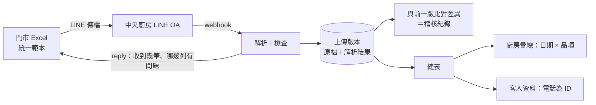

# 需求：喜餅訂單 Excel → 中央廚房 LINE OA

題目原文與 Jack 的初步分析：`~/ootobai/vault/scratch-pad/AIFIAN.md`。

## 1. 情境

中部老字號糕餅連鎖，6 家門市＋1 個中央廚房。喜餅約占營收四成。門市用電話和 LINE OA 接喜餅訂單，各店記在自己的 Excel，再用 LINE 把檔案傳給中央廚房，廚房才知道下週要做多少。上一季有 3 筆訂單日期或數量記錯，造成退款和負評。POS 是外包的，只能每晚匯出 CSV，改功能要一個月起跳。老闆想要「跟大品牌一樣的會員 App」。

## 2. 設計原則

門市人員多半是做了 10、20 年的資深員工，從紙筆走到 Excel 已經花了很長時間。這次**不要求她們學新系統**。

- 門市照舊：電話接單、記在自己店裡的 Excel。
- 只改兩件事：(1) 各店改用統一範本；(2) 原本把 Excel 用 LINE 傳給中央廚房，改成傳給中央廚房的 LINE OA。
- 改動都放在門市看不到的這一側：解析、合併、稽核、建立客人資料，全部在後端完成。
- 處理流程不用 AI。範本格式一致，就能用確定的規則合併和檢查，結果每次都一樣，也能逐筆追溯。
- 會員系統的第一步不是 App，是把已經在 Excel 裡的資料（姓名、電話、訂單）數位化，用電話當客人 ID 累積客人資料。

## 3. 角色

| 角色 | 做什麼 | 介面 |
|---|---|---|
| 門市人員 | 照舊記 Excel，傳到 LINE OA | LINE（已經會用） |
| 中央廚房／總部 | 看總表、生產彙總、處理檢查警示 | 網頁 |
| 老闆 | 看客人資料與訂單趨勢 | 網頁 |

## 4. Functional Requirements

| ID | 優先 | 需求 |
|---|---|---|
| FR-01 | Must | **統一範本**（.xlsx）：欄位盡量貼近各店現有格式。品項用 Excel 內建的下拉選單，門市代碼與範本版本寫在固定儲存格。範本本身就是交付物 |
| FR-02 | Must | **LINE OA 收檔**：接收 webhook 的 file 事件，立刻下載原檔保存。用「傳檔者的 LINE 帳號已綁定哪家門市」比對範本裡的門市代碼，兩者不一致就拒收並回覆原因 |
| FR-03 | Must | **解析與檢查**：分「錯誤」（該列不進總表）和「警告」（照收但標示）兩級。錯誤：必填欄位空白、日期無法解析、數量不是正整數、品項不在清單裡。警告：新訂單的取貨日已經過去、取貨日離今天比製作前置期還近、數量超過門檻、電話格式異常、同一支電話同一天重複下單。日期要能吃民國年、西元年、`10/25` 這類寫法 |
| FR-04 | Must | **每一份上傳都回覆**：用 reply 回給傳檔的人，內容包括收到幾筆、新增幾筆、修改幾筆、消失幾筆，以及每一列錯誤或警告的 Excel 列號和原因，文字要讓門市人員看得懂。不能有檔案傳了卻沒回應 |
| FR-05 | Must | **版本與差異**：每次上傳都當成該店的完整快照，原檔不可修改。跟該店前一版比對，產生「新增／修改（欄位、舊值、新值）／消失」紀錄。消失的訂單要標示出來，因為可能是取消，也可能是誤刪 |
| FR-06 | Must | **總表**：合併各店最新一版，可依門市、取貨日篩選，可下載 .xlsx |
| FR-07 | Must | **廚房生產彙總**：未來 14 天依「取貨日 × 品項」加總，可展開看各門市的明細 |
| FR-08 | Must | **稽核頁**：任一筆訂單的完整變更歷史，包括哪一次上傳、誰傳的、什麼時間、改了哪個欄位 |
| FR-09 | Must | **客人資料**：電話正規化（手機、市話、+886）後當作客人 ID，彙整訂單數、總盒數、金額、第一次和最近一次訂購日、下過單的門市。同一支電話對應到不同姓名時要標示 |
| FR-10 | Should | **週鎖定**：可以把某一週的生產量鎖定，之後的變更另外列成差異清單給廚房 |
| FR-11 | Should | **漏傳提醒**：門市超過約定時間沒有上傳，就在總部頁面上標示 |
| FR-12 | Could | 匯入 POS 每晚的 CSV，對帳喜餅尾款和已取貨的訂單（take-home 不做，只寫進提案） |

## 5. Non-Functional Requirements

| 類別 | 需求 |
|---|---|
| 門市學習成本 | 除了統一範本和換一個傳送對象，門市沒有任何新介面、新帳號、新操作 |
| 不會悄悄失敗 | 每一個 webhook 事件都要有結果：成功、部分錯誤或拒收，而且都會回覆。解析出錯時保存原檔，並記錄錯誤原因 |
| 冪等 | LINE 會重送 webhook，依 `webhookEventId` 去重；同一個檔案重複上傳時，不產生假的差異 |
| 可稽核 | 原檔和差異紀錄只增不改（append-only） |
| 確定性 | 處理流程不用 LLM。同一份輸入一定得到同樣的輸出 |
| 個資 | 總表、客人資料、稽核頁都要登入才能看；全程 HTTPS；log 不寫入姓名和電話；demo 只用模擬資料 |
| 不動 POS | POS 一行都不改 |
| 成本 | LINE OA 只用 reply（不吃推播額度），用免費方案就夠；託管用最小規格 |
| 規模 | 6 店、每月數十到一百多筆訂單，不需要 scaling 設計 |
| 可退出 | 全部資料可以匯出 .xlsx 或 CSV |
| 時效 | LINE 上的檔案內容只保存一段時間，收到 webhook 就要立刻下載（保存期限待查證） |

## 6. Operation Requirements（不靠軟體，但一樣要交付）

| ID | 需求 |
|---|---|
| OR-01 | 上一季 3 筆事故逐筆回溯：錯在接單、改單、傳檔、彙總還是交付哪一段？誰發現、什麼時候發現？ |
| OR-02 | 傳檔規則：每天打烊前傳一次，接到新單或改單時多傳一次 |
| OR-03 | 範本導入：先跟各店對過欄位再定稿；每店指定一位負責傳檔的人，綁定她的 LINE 帳號 |
| OR-04 | 檢查警示由誰處理、多久內處理（總部打電話給門市確認） |
| OR-05 | 並行期：舊流程（傳給廚房）和新流程（傳給 OA）並行 2 週，對過帳才切換 |
| OR-06 | 中途被抓到的錯誤（near-miss）也要記錄，每月 review |

## 7. 不在範圍內

- 門市改用表單或 App 輸入
- 客人用 LINE 確認訂單、自動提醒（下一階段：客人資料建好之後再接）
- 會員 App
- 修改 POS、線上金流
- 用 AI 解析 LINE 對話

## 8. 待定的設計決策

| # | 問題 | 選項 |
|---|---|---|
| D1 | 前後兩版之間，怎麼判斷是不是同一筆訂單 | (a) 範本加一欄「單號」（門市代碼＋流水號），要多請門市做一件事；(b) 用「電話＋接單日」當 key，兩者很少會改，但同一位客人同一天下兩張單會撞；(c) 兩者並用，有單號用單號、沒有就退回 (b) |
| D2 | 怎麼判斷是哪家門市傳的 | LINE 帳號綁門市＋範本裡的門市代碼互相驗證（FR-02 的預設做法）；綁定流程可以先簡化成管理者手動設定 |
| D3 | 部署在哪 | Cloud Run＋Neon／Cloud SQL，或 Railway（app＋Postgres 在同一個地方） |
| D4 | 網頁登入 | demo 用 HTTP Basic Auth；正式版改用總部帳號 |

## 9. 要跟客戶確認的問題

1. 3 筆事故各自的經過（OR-01）。
2. 中途被抓到、沒有釀成事故的錯誤有幾筆。
3. 各店 Excel 的實際欄位；還有沒有人用手寫。
4. 現在多久傳一次 Excel、傳給誰（群組還是個人）。
5. LINE OA 是總部統一一個，還是各店各自一個。
6. 廚房多久前要知道數量；每天產能上限是多少。
7. 每月喜餅訂單量、平均盒數、客人提前多久下單、多少比例會改單。
8. 訂金和尾款怎麼收，有沒有打進 POS。
