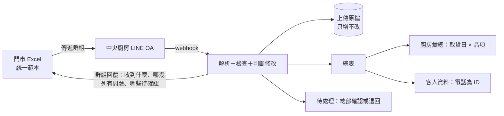

# 需求：喜餅訂單 Excel → 中央廚房 LINE OA

名詞定義以 `GLOSSARY.md` 為準；「一次上傳是一批訂單明細，不是快照」見 `docs/adr/0001-upload-is-a-batch-not-a-snapshot.md`。

術語：**客戶**是委託我們的糕餅公司，**客人**是買喜餅的人。

## 1. 情境

中部老字號糕餅連鎖，6 家門市加 1 個中央廚房，喜餅約占營收四成。門市用電話和 LINE 官方帳號接喜餅訂單，各店記在自己的 Excel，再用 LINE 把檔案傳給中央廚房，廚房收到後才知道下週要做多少。上一季有 3 筆喜餅訂單日期或數量記錯，造成退款和負評。POS 由外包廠商維護，每晚只能匯出一份 CSV（日期、門市、品項、數量、金額），改功能要報價、排期一個月起跳。老闆想要「跟大品牌一樣的會員 App」。

## 2. 設計原則

- **門市不學新系統。** 門市照舊用電話接單、記 Excel。只改兩件事：改用統一範本；檔案傳進有中央廚房 LINE OA 的現有群組（OA 加進群組，傳檔對象不變）。門市沒有網頁帳號。
- **改動放在門市看不到的一側。** 解析、合併、檢查、修改判斷、客人資料，全部在後端完成。
- **處理流程不用 AI。** 範本一致，就能用固定規則處理，同樣的輸入一定得到同樣的結果，每一筆都能追溯。
- **不猜。** 單號不用電話去猜，品項不做模糊比對，廚房彙總不推算生產日，不拿分不清情境的 POS 數字對帳。猜錯會直接變成我們要解決的那種錯。
- **先解決眼前的問題，再談會員。** 第一階段處理喜餅訂單出錯和廚房拿不到數字；會員要等第一次開會問清楚老闆的目的再決定。

## 3. 角色與介面

| 角色 | 做什麼 | 介面 |
|---|---|---|
| 傳檔者（門市的個人或共用 LINE 帳號） | 照舊記 Excel，傳進群組 | LINE（已經會用） |
| 總部人員（每人一個帳號） | 確認或退回待確認、維護品項清單與門市綁定、看總表 | 網頁 |
| 中央廚房（共用一個帳號） | 看廚房彙總與總表 | 網頁 |
| 老闆（一個帳號） | 看全部，包括客人資料 | 網頁 |

## 4. 範本

| ID | 需求 |
|---|---|
| T-01 | 一列是一筆訂單明細（一個品項＋盒數），用單號把同一張喜餅訂單的多列串起來 |
| T-02 | 整張訂單層級的欄位：單號、電話、訂購人姓名、接單日（必填）、取貨日（必填）、宴客日（選填）、新人姓名（選填）、接單人（選填）。同一單號的每一列這些欄位必須一致，不一致整張單退回 |
| T-03 | 明細層級的欄位：品項（下拉選單）、盒數、備註、狀態（下拉選單只有「取消」，平常留空） |
| T-04 | 一張喜餅訂單只有一個取貨日。要分兩次取貨就開兩個單號 |
| T-05 | 單號由門市自己編，同一家門市內不重複；門市已有編號的紙本訂購單就沿用。沒填單號的列不收，回覆列出列號。不用電話去猜是哪一張單 |
| T-06 | 門市代碼與範本版本寫在固定儲存格。新增品項時總部把新範本傳到群組，舊版範本仍然可以用 |
| T-07 | 解析放寬：欄位順序可以不同，欄名接受同義寫法（電話／手機／聯絡電話）；門市自己多加的欄位略過不報錯 |
| T-08 | 每一個欄名比對得上範本的分頁都讀；比對不上的分頁略過，回覆寫「略過分頁：○○」。分頁的門市代碼跟檔案其他分頁不同，該分頁略過並在回覆裡列出。同一單號在兩個分頁內容完全相同只算一次；內容不一致，整張單退回 |
| T-09 | 日期接受民國年、西元年、`10/25` 這類寫法 |
| T-10 | 範本不放「取貨門市」欄。取貨、配貨照現有流程，廚房彙總算在接單門市 |

## 5. Functional Requirements

| ID | 優先 | 需求 |
|---|---|---|
| FR-01 | Must | **群組收檔**：OA 加進現有群組（需在 LINE Developers Console 開啟允許加入群組）。收到 file 事件就立刻下載原檔存進資料庫，因為 LINE 不保證檔案保存多久。支援「六家門市＋廚房一個大群組」，也支援「每家門市各一個群組」 |
| FR-02 | Must | **判斷是哪家門市**：以範本裡的門市代碼為準，再跟傳檔者的 LINE 帳號交叉比對。一家門市可以有多位傳檔者（個人帳號或門市共用帳號），一位傳檔者只屬於一家門市。新帳號第一次傳檔，回覆第一行寫「已記錄您為 ○○門市（待總部確認）」，總部在網頁上確認。綁定確認前照常處理，總表標示「傳檔者待確認」。已綁定的帳號傳別家門市的檔案，照收但出警告 |
| FR-03 | Must | **一次上傳是一批訂單明細**：檔案裡沒出現的單不代表任何事（不是快照，不做消失比對）。只傳當天新單和修改可以，每天整份傳也可以；內容完全沒變的明細不做任何事，也不出現在回覆裡 |
| FR-04 | Must | **檢查**：分「錯誤」（該列或整張單不收）和「警告」（照收但標示）。錯誤包括：沒有單號、必填欄位空白、日期無法解析、盒數不是正整數、品項不在清單和別名裡、同一單號的整單欄位不一致、同一張單在同一個分頁裡同一品項出現兩次、狀態欄填了「取消」以外的值 |
| FR-05 | Must | **品項清單與別名**：總部在網頁上維護品項清單，每一款可以設幾個別名。比對時名稱和別名都認，比不到就不收，回覆寫「第 12 列品項『月下』不在清單裡」。總部補上別名後門市重傳即可。不做模糊比對 |
| FR-06 | Must | **修改自動分類**：同一單號再出現且內容不同就是修改。系統比對前後兩版，自動分成：追加（盒數變多或多了品項）、減量（盒數變少但不到 0）、改取貨日、取消、資料更正（只改了訂購人姓名、電話、宴客日、新人姓名或備註）、疑似單號重複使用（電話變了，同時品項或取貨日也變了）。一次修改可以同時屬於好幾類。只改電話時，回覆寫「單號 ○○ 的電話跟之前不同」 |
| FR-07 | Must | **修改截止點**：影響生產的修改（品項、盒數、取貨日、取消）在取貨日前 N 天以前直接覆寫；過了截止點，不套用，狀態變成「待確認」。N 預設 7，總部在網頁上可以調整，實際天數要跟客戶談定。資料更正一律直接覆寫。疑似單號重複使用不看截止點，一律待確認 |
| FR-08 | Must | **待確認與退回**：網頁上的「待處理」清單，由總部人員確認或退回。確認或退回的結果不另外推播，附在該門市下一次上傳的回覆最前面，例如「上次待確認：單號 ○○ 盒數改為 120，總部已確認」 |
| FR-09 | Must | **重複送來的同一筆修改**：內容跟上次相同的修改不重複建立待確認。還在等總部時回覆「單號 0123 盒數 120 仍待總部確認」；已被退回時回覆「單號 0123 盒數 120 已被總部退回，系統仍以 80 盒計算，請把 Excel 改回 80」。門市改回之後提醒就消失 |
| FR-10 | Must | **每一份上傳都回覆**：在群組裡用 reply（不計費）回覆，寫明是哪家門市的檔案、收到幾張新單、幾筆修改（含類型，例如「單號 0123：追加，喜餅 A 80→120 盒（已過截止點，待總部確認）」）、每一列錯誤或警告的 Excel 列號和原因，最後附廚房彙總頁的連結。不能有檔案傳了卻沒回應。回覆超過 LINE 單則 5,000 字上限時，保留摘要和前幾項問題，結尾寫「其餘 X 項請看網頁：連結」 |
| FR-11 | Must | **修改紀錄**：每一筆修改都留下誰傳的、什麼時間、舊值、新值、修改類型；待確認由哪一位總部人員確認或退回，也要記下 |
| FR-12 | Must | **總表**：合併所有門市的訂單明細，可依門市、取貨日篩選，可下載 .xlsx |
| FR-13 | Must | **廚房彙總**：只用取貨日，依「取貨日 × 品項」加總盒數，可展開看各門市明細，可下載 .xlsx。哪一款要提前幾天做由廚房判斷，系統不推算。歷史資料一律不算進廚房彙總：門市上線後會用正式單號重新記這些單，算進去會重複 |
| FR-14 | Must | **客人資料**：客人是一支正規化後的電話（手機、市話、+886）。彙整訂單數、總盒數、第一次和最近一次接單日、下過單的門市；一支電話可以有多個訂購人姓名。新人不是客人。客人資料只供內部查詢，不用來發訊息，也不是會員 |
| FR-15 | Must | **歷史資料匯入**：上線前各門市的舊 Excel，由我們逐份轉成範本格式（導入服務，不是產品功能），從網頁匯入並標成「歷史資料」，不套用修改截止點，也不發 LINE 回覆，不算進廚房彙總。只建客人資料，不建會員 |
| FR-16 | Must | **網頁登入**：總部人員每人一個帳號，廚房共用一個，老闆一個。demo 用預先建好的帳號，帳密寫在 README |
| FR-17 | Must | **模擬群組上傳頁（demo 用）**：選一個傳檔者、上傳 .xlsx，畫面上顯示的回覆文字跟 LINE 收到的完全一樣，走同一條處理流程。只有 demo 帳號看得到，頁面標明「demo 用，門市不會看到」 |
| FR-18 | Must | **demo 資料**：repo 內附 6 家門市的模擬檔，各自混進典型錯誤；兩家門市各一份舊格式檔示範歷史資料轉換。一行指令跑完整個 demo 腳本 |

## 6. Non-Functional Requirements

| 類別 | 需求 |
|---|---|
| 門市學習成本 | 除了統一範本，門市沒有新介面、新帳號、新操作 |
| 不會悄悄失敗 | 每一個檔案事件都有結果並回覆：成功、部分錯誤或不收。解析出錯時保存原檔並記錄原因 |
| 冪等 | LINE 可能重送同一個事件，依 `webhookEventId` 去重；同一份檔案重傳不產生假的修改 |
| 可稽核 | 原檔和修改紀錄只增不改。稽核紀錄回答「哪個帳號在什麼時間傳了什麼」；要追到哪一位店員，靠範本的接單人欄和 operation |
| 確定性 | 處理流程不用 LLM |
| 個資 | 總表、客人資料都要登入才能看；全程 HTTPS；log 不寫入訂購人姓名和電話；demo 只用模擬資料 |
| 不動 POS | MVP 不讀、不改 POS |
| 成本 | 只用 reply，不用 push（push 到群組依人數計費，免費方案每月只有 200 則）。Cloud Run＋Neon 免費額度 |
| 時區 | 「今天」與截止點一律以 `Asia/Taipei` 計算 |
| 規模 | 6 家門市、每月數十到一百多筆訂單，不做 scaling 設計 |
| 可退出 | 總表、廚房彙總、待處理、客人資料都能下載 .xlsx |

## 7. Operation Requirements（不靠軟體，但一樣要交付）

| ID | 需求 |
|---|---|
| OR-01 | **編號訂購單**：每家門市都要有自己的單號制度。已有編號紙本訂購單的沿用；沒有的，我們幫門市印預先編好號的喜餅訂購單（例如「中正店 0001–0500」），接電話時照樣手寫，鍵入 Excel 時抄上號碼。客人來改單時，由門市負責找回原本那張單 |
| OR-02 | **傳檔規則**：每天打烊前傳一次；接到新單或改單時可以多傳。每張單由接單人負責到客人取貨 |
| OR-03 | **待確認處理 SOP**：誰看待處理清單、多久內處理；急件由總部人員直接打電話給門市，不等下一次回覆 |
| OR-04 | **新舊流程並行期**：試行門市新舊流程並行約 2 週，對過數字才切換 |
| OR-05 | **near-miss 紀錄**：在取貨前被抓到並改正的錯誤也要記錄，每月檢討 |
| OR-06 | **事故回溯**：上一季 3 筆事故逐筆問清楚錯在接單、改單、傳檔、彙總還是交付哪一段 |
| OR-07 | **修改截止點**：跟客戶談定 N 天或固定鎖定時間，寫進 SOP |

## 8. 不在範圍內（以及原因）

| 不做 | 原因 |
|---|---|
| 門市改用表單或 App 輸入 | 門市人員從紙筆走到 Excel 已經花了很久，再換工具就是新的出錯來源 |
| 快照比對（檔案少了某筆就當成取消） | 門市每天傳的是一批訂單，不是全店清單；少了一列不代表任何事（ADR 0001） |
| 範本放「取貨門市」欄、宅配、配貨 | 照現有流程，在哪接單就在哪取貨 |
| push 通知 | 依群組人數計費，免費額度撐不久；改用 reply 加上下一次回覆附帶結果，急件打電話 |
| POS 對帳 | POS 分不出喜餅訂單取貨和現場購買，對帳數字不可靠。第二階段視 POS 廠商能否開獨立品項再做 |
| 會員、會員 App、發行銷訊息 | 要先問清楚老闆為什麼要會員；客人電話拿去行銷屬於目的外利用，需要客人另外同意 |
| 用 AI 解析 Excel 或 LINE 對話 | 結果要每次一樣、可追溯 |
| 修改 POS、線上金流 | 不在這次問題範圍 |

## 9. 第一次開會要問的問題

詳見 `docs/design.md`「第一次開會要問的問題」。重點：會員的三個問題、修改截止點、群組裡有沒有別的 bot（一個群組只能有一個 bot）、喜餅取貨有沒有走 POS、POS 能不能另開喜餅取貨品項、客人資料的目的外利用、3 筆事故的經過。
