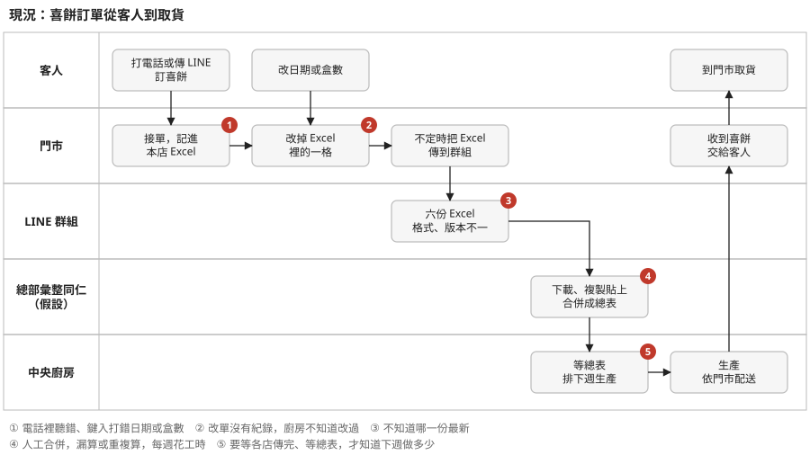
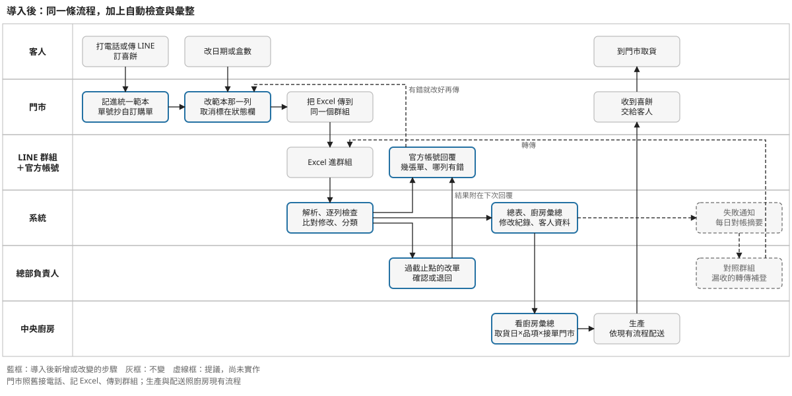

# 喜餅訂單流程：現況與導入後

兩張泳道圖，從客人訂喜餅到在門市拿到喜餅。「總部彙整同仁」這一道是假設，還沒跟客戶確認（設計說明 §1 的 A7）。

## 現況

圖上紅色編號是會出錯或卡住的地方，說明在圖下方。

## 導入後

## 改了什麼、沒改什麼

| 環節 | 現況 | 導入後 |
|---|---|---|
| 客人訂單、改單 | 電話或 LINE | 不變 |
| 門市記錄 | 各店自己的 Excel 格式，沒有單號 | 統一範本，單號抄自編號訂購單；接電話、記 Excel 的習慣不變 |
| 門市傳檔 | 把 Excel 傳到 LINE 群組 | 不變，群組裡多了中央廚房的官方帳號 |
| 檢查 | 沒有人檢查，錯到客人取貨才發現 | 每份檔案自動逐列檢查，當場回覆哪一列有問題 |
| 改單 | 改掉 Excel 的一格，沒有紀錄 | 系統比對前後版本，記下誰在什麼時間改了什麼；過了截止點的改單要總部確認 |
| 彙整 | 總部同仁人工合併六份 Excel | 系統自動合併成總表；同仁改做確認改單、對帳補登 |
| 廚房拿數字 | 等各店傳完、等總表 | 隨時看廚房彙總，可下載 Excel |
| 生產與配送 | 廚房排生產，依門市配送 | 不變；各門市列是接單門市，送到哪家店照現有流程決定 |
| 交給客人 | 門市交貨 | 不變 |
